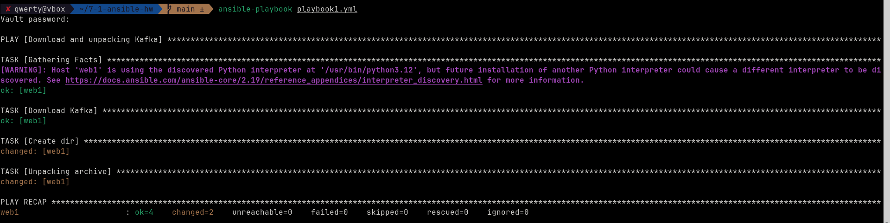
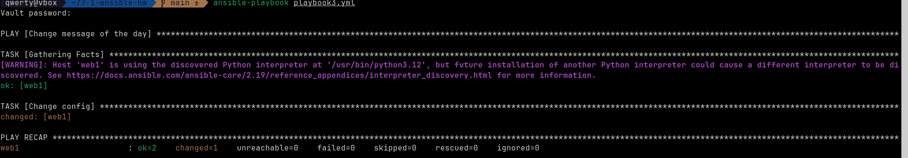
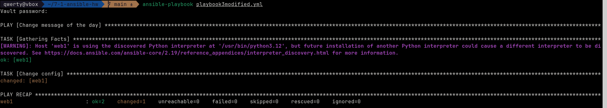
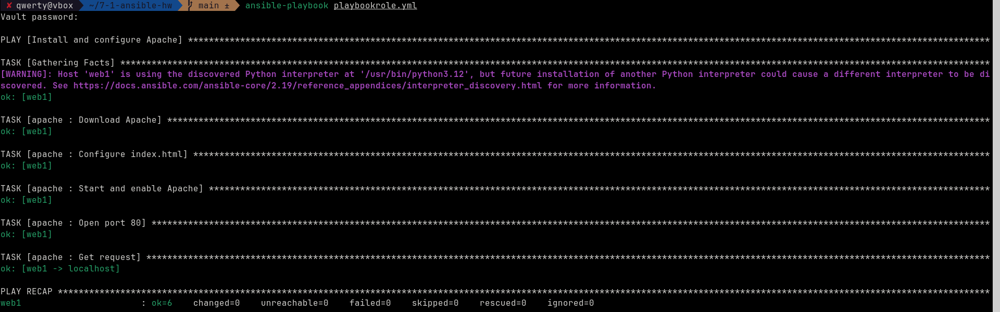

# Домашнее задание к занятию "Ansible. Часть 2" - Качьянов Вадим
      - для корректного добавления скриншотов воспользуйтесь [инструкцией "Как вставить скриншот в шаблон с решением](https://github.com/netology-code/sys-pattern-homework/blob/main/screen-instruction.md)
      - при оформлении используйте возможности языка разметки md (коротко об этом можно посмотреть в [инструкции  по MarkDown](https://github.com/netology-code/sys-pattern-homework/blob/main/md-instruction.md))
   4. После завершения работы над домашним заданием сделайте коммит (`git commit -m "comment"`) и отправьте его на Github (`git push origin`);
   5. В личном кабинете прикрепите и отправьте ссылку на решение в виде md-файла в вашем Github.
   6. Любые вопросы по выполнению заданий спрашивайте в разделе “Вопросы по заданию” в личном кабинете.

### Задание 1

Было написано 3 плейбука, результаты выполнения на рисунках:


1. ```
---
- name: Download and unpacking Kafka
  hosts: web

  tasks:
    - name: Download Kafka
      ansible.builtin.get_url:
        url: https://downloads.apache.org/kafka/4.1.2/kafka-4.1.2-src.tgz
        dest: /tmp/kafka-4.1.2-src.tgz
        mode: "0644"

    - name: Create dir
      ansible.builtin.file:
        path: /home/vadim/kafka
        state: directory
        mode: "0755"

    - name: Unpacking archive
      ansible.builtin.unarchive:
        src: /tmp/kafka-4.1.2-src.tgz
        dest: /home/vadim/kafka
        remote_src: true
        creates: /home/vadim/kafka/kafka-4.1.2-src
```

2. ```
---
- name: Download and start daemon "tuned"
  hosts: web
  become: true

  tasks:
    - name: Install "tuned"
      ansible.builtin.apt:
        name: tuned
        state: present
        update_cache: true

    - name: Start daemon
      ansible.builtin.systemd:
        name: tuned
        state: started
        enabled: true

```

3. ```
---
- name: Change message of the day
  hosts: web
  become: true

  vars:
    motd_txt: "Welcome!"

  tasks:
    - name: Change config
      ansible.builtin.copy:
        dest: /etc/motd
        content: "{{ motd_txt }}\n"

```

Скриншоты:
1. 
2. 
3. 


### Задание 2

В данном задании был модифицрован 3 плейбук


```
---
- name: Change message of the day
  hosts: web
  become: true

  vars:
    motd_txt: |
      Hostname: {{ ansible_facts['hostname'] }},
      IP address: {{ ansible_facts['default_ipv4']['address'] }}.
      Have a nice day, sysadmin!

  tasks:
    - name: Change config
      ansible.builtin.copy:
        dest: /etc/motd
        content: "{{ motd_txt }}\n"

```

Скриншот:
1. 


### Задание 3

В данном задании была написана роль

```
---
# tasks file for roles/apache
- name: Download Apache
  ansible.builtin.apt:
    name: apache2
    state: present
    update_cache: true
  
- name: Configure index.html
  ansible.builtin.template:
    src: index.html.j2
    dest: /var/www/html/index.html
    mode: "0644"
  notify: Reload Apache

- name: Start and enable Apache
  ansible.builtin.service:
    name: apache2
    state: started
    enabled: true

- name: Open port 80
  community.general.ufw:
    rule: allow
    port: "{{ apache_port }}"
    proto: tcp
  
- name: Get request
  ansible.builtin.uri:
    url: "http://{{ ansible_host }}"
    status_code: 200
  delegate_to: localhost
  become: false
```


`
